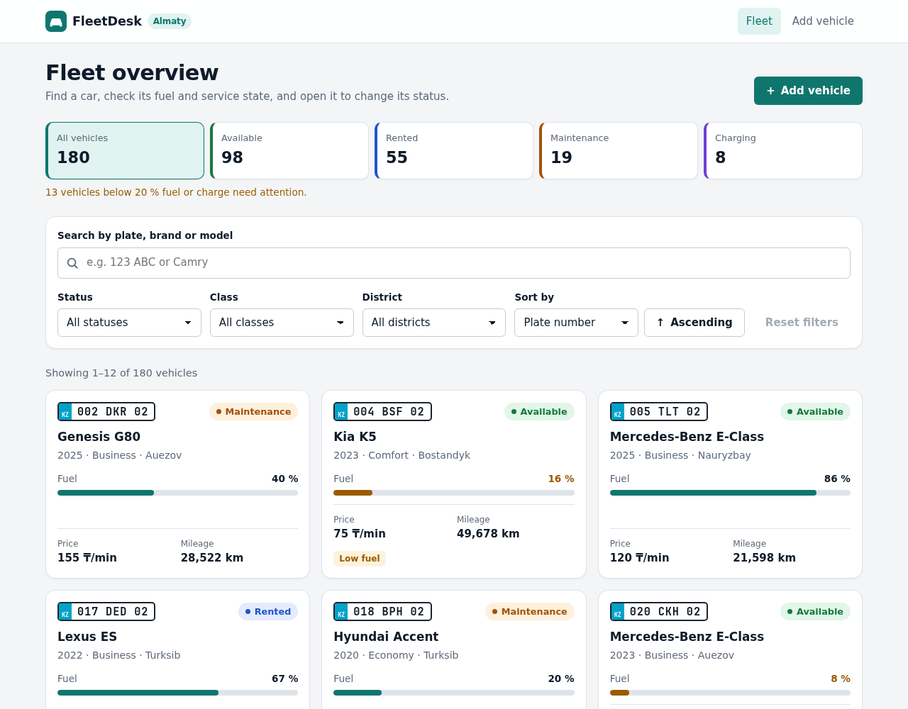
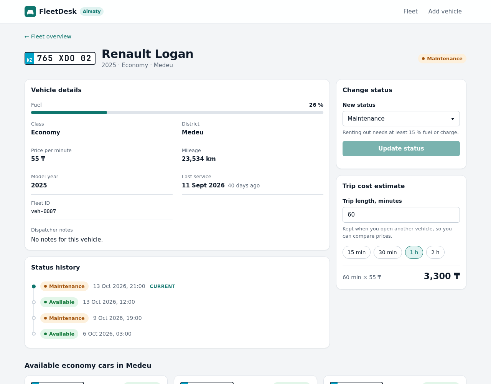
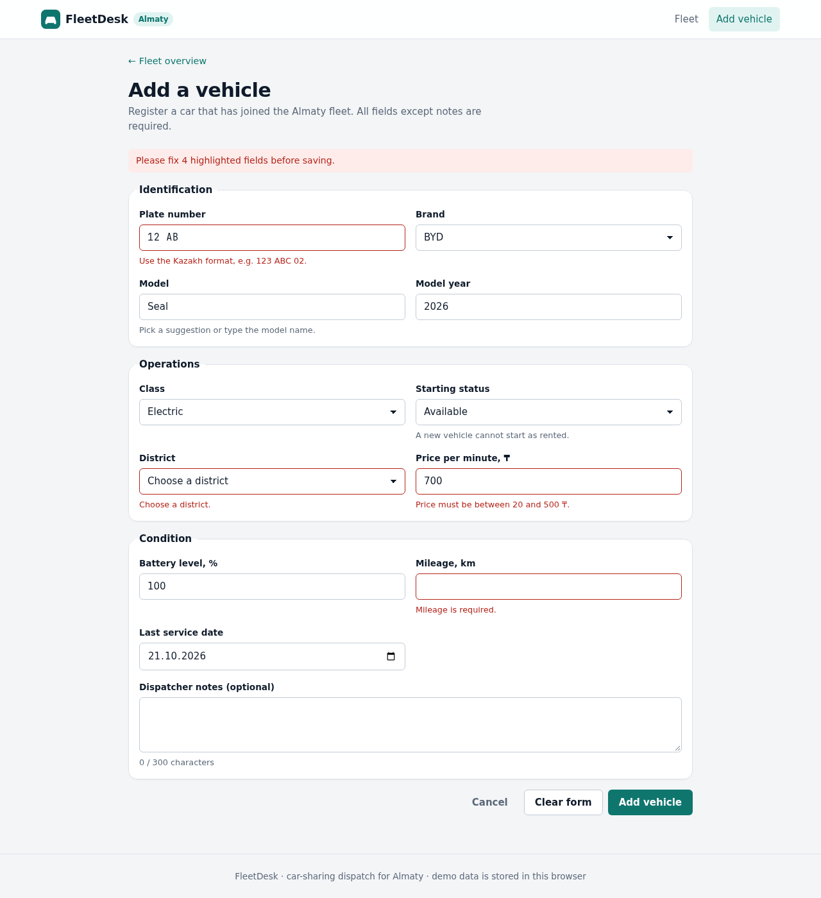
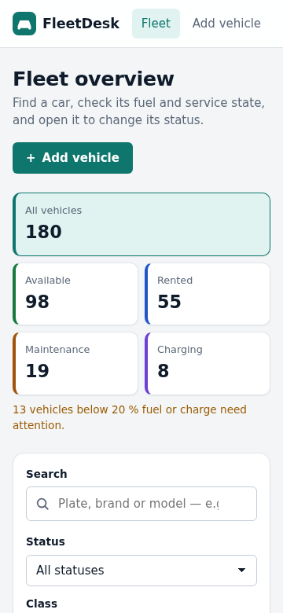
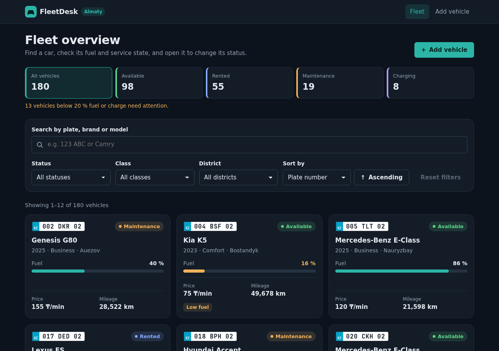

# FleetDesk — car-sharing dispatch for Almaty

FleetDesk is a single-page React application for a dispatcher who runs a car-sharing fleet in Almaty.
The dispatcher can find any of the 180 cars, see which ones are low on fuel or overdue for service,
open a car to change its status (available / rented / maintenance / charging), estimate the cost of a
trip, find an available replacement nearby, and register new cars joining the fleet.

All data comes from a **simulated REST-like API** that lives in `src/api/`: it answers with Promises
after a realistic network delay, supports request cancellation, and stores the fleet in `localStorage`,
so changes survive page reloads.

> Midterm project for the React course (KBTU). Requirements checklist: [`docs/REQUIREMENTS.md`](docs/REQUIREMENTS.md).
> Architecture decisions: [`docs/DECISIONS.md`](docs/DECISIONS.md). Defense guide (in Russian): [`docs/DEFENSE.md`](docs/DEFENSE.md).

## Screens and features

| Fleet overview | Vehicle details |
| --- | --- |
|  |  |

| Add a vehicle (validation) | Mobile (360 px) | Dark theme |
| --- | --- | --- |
|  |  |  |

**Fleet overview** (`#/`)
- Summary tiles with the number of cars per status; a tile also works as a one-click status filter.
- Search by plate, brand or model (debounced, 400 ms). Plates match with or without spaces: `123abc` finds `123 ABC 02`.
- Filters by **status**, **class** and **district**; sorting by plate, price per minute, fuel/charge, mileage, model year or last service date, ascending or descending.
- Pagination with 12 / 24 / 48 cars per page. Changing the search, a filter or the sort order returns to page 1.
- Search, filters, sort and page are kept for the browser tab, so coming back from a car's page restores the same view.
- Every card shows the plate, status, fuel/battery gauge, price, mileage and warnings ("Low fuel", "Service overdue").
- Loading, error (with **Retry**), empty (with **Reset filters**) and success states. While a new page loads, the previous results stay visible but dimmed.

**Vehicle details** (`#/vehicles/:id`)
- All vehicle fields, days since the last service with an "Overdue" flag after 180 days, dispatcher notes.
- **Change status**: validated by the API (charging is only for electric cars; renting needs at least 15 % fuel/charge). The status history timeline updates immediately.
- **Trip cost estimate**: enter minutes or use a preset. The value is kept when you open another car, so prices can be compared.
- **Available cars of the same class in the same district**: replacement candidates, sorted by fuel level.
- Separate "Vehicle not found" state for unknown ids.

**Add a vehicle** (`#/vehicles/new`)
- Fully controlled form with 12 fields grouped into sections.
- Validation messages appear next to fields after the field is left or on submit. Cross-field rules: a non-electric car cannot start as "charging" (the status falls back automatically), the service date cannot be in the future or before the model year.
- The API validates again and rejects duplicate plates; server errors are shown next to the relevant field and the entered data is kept.
- The submit button is locked while saving; on success the app opens the new car's page.

**Accessibility**: semantic landmarks, a `<label>` for every control, visible focus rings, `aria-live` regions for loading/results/errors, `aria-pressed` on toggle tiles and chips, `aria-current` on the current page, and `prefers-reduced-motion` support.

## Tech stack

- [React 18](https://react.dev/) (JavaScript + JSX), hooks only: `useState`, `useEffect`, plus two small custom hooks built on them
- [React Router 7](https://reactrouter.com/) with a hash router (`createHashRouter`)
- [Vite 8](https://vite.dev/) for the dev server and production build
- Plain CSS with custom properties (light and dark theme, mobile-first)
- ESLint 9 with `eslint-plugin-react`, `eslint-plugin-react-hooks` and custom rules that forbid direct DOM access and index keys

No UI kits, no state-management or data-fetching libraries.

## Getting started

Requirements: Node.js 20 or newer.

```bash
npm install
npm run dev        # http://localhost:5173
```

| Script | What it does |
| --- | --- |
| `npm run dev` | Start the dev server with hot reload |
| `npm run build` | Build the production bundle into `dist/` |
| `npm run preview` | Serve the production build locally (http://localhost:4173) |
| `npm run lint` | Run ESLint; fails on any error or warning |

## Project structure

```
.
├── docs/                       # requirements checklist, decisions, defense guide, screenshots
├── public/favicon.svg
├── src/
│   ├── api/
│   │   ├── network.js          # simulated latency, AbortSignal support, ApiError, ?simulateError
│   │   ├── seed.js             # deterministic generator of the 180 initial vehicles
│   │   ├── storage.js          # localStorage "database" with a schema version
│   │   └── vehiclesApi.js      # listVehicles, getVehicle, getFleetStats, createVehicle, updateVehicleStatus
│   ├── components/             # reusable UI: VehicleCard, FilterPanel, Pagination, VehicleForm, ...
│   ├── hooks/
│   │   ├── useDebouncedValue.js
│   │   └── useSessionState.js
│   ├── pages/                  # route components: VehiclesPage, VehicleDetailsPage, NewVehiclePage, NotFoundPage
│   ├── styles/                 # tokens.css, base.css, layout.css, components.css, pages.css
│   ├── utils/                  # constants, formatting, validation, vehicle helpers
│   ├── App.jsx                 # router configuration
│   └── main.jsx                # React root
├── eslint.config.js
├── index.html
└── vite.config.js
```

## Simulated API

`src/api/vehiclesApi.js` behaves like a small REST backend:

| Method | Returns | Notes |
| --- | --- | --- |
| `listVehicles(params, { signal })` | `{ items, total, page, pageSize }` | Search, filters, sorting and pagination happen here, not in components |
| `getVehicle(id, { signal })` | vehicle | `ApiError` with `status: 404` for an unknown id |
| `getFleetStats({ signal })` | `{ total, byStatus, lowFuel }` | Counts for the summary tiles |
| `createVehicle(data)` | created vehicle | `422` with `fieldErrors` on invalid data, `409` on a duplicate plate |
| `updateVehicleStatus(id, status)` | updated vehicle | `422` when a business rule is broken, appends to `statusHistory` |

`listVehicles` params: `search`, `status`, `vehicleClass`, `district` (each filter accepts `'all'`),
`sortBy` (`plate`, `pricePerMinute`, `fuelLevel`, `mileageKm`, `year`, `lastServiceDate`), `sortDir` (`asc` / `desc`),
`page` (from 1) and `pageSize` (1–48).

How it simulates a real server:
- **Latency**: every call waits a random 400–900 ms.
- **Cancellation**: read methods accept an `AbortSignal`; aborting rejects the Promise with a `DOMException` named `AbortError`. Components abort outdated requests in their effect cleanup.
- **Persistence**: data is kept in `localStorage` under the key `fleetdesk.db` as `{ version, nextId, vehicles }`. On first launch it is seeded with **180 vehicles** generated deterministically (fixed PRNG seed), so every visitor starts with the same fleet.
- **Copies**: responses are deep copies, so the UI can never mutate the stored data by accident.
- **Re-seeding**: to restore the initial data, run `localStorage.removeItem('fleetdesk.db')` in the browser console and reload, or bump `SCHEMA_VERSION` in `src/api/storage.js` (every browser then re-seeds automatically).

A vehicle looks like this:

```json
{
  "id": "veh-0007",
  "plate": "765 XDO 02",
  "brand": "Renault",
  "model": "Logan",
  "class": "economy",
  "status": "maintenance",
  "district": "Medeu",
  "fuelLevel": 26,
  "mileageKm": 23534,
  "pricePerMinute": 55,
  "year": 2025,
  "lastServiceDate": "2026-09-11",
  "notes": "",
  "statusHistory": [
    { "status": "maintenance", "changedAt": "2026-10-13T16:00:00.000Z" },
    { "status": "available", "changedAt": "2026-10-13T07:00:00.000Z" },
    { "status": "maintenance", "changedAt": "2026-10-09T14:00:00.000Z" },
    { "status": "available", "changedAt": "2026-10-05T22:00:00.000Z" }
  ]
}
```

### Simulating errors: `?simulateError`

Add the `simulateError` query parameter to the URL to test the error states:

| URL | Effect |
| --- | --- |
| `http://localhost:5173/?simulateError=1#/` | every API request fails with a 500 error |
| `http://localhost:5173/?simulateError=0.3#/` | about 30 % of requests fail (good for trying **Retry**) |
| `http://localhost:5173/#/vehicles/veh-0001?simulateError=1` | the parameter also works inside the hash route |

A yellow banner under the header shows that the mode is on. Remove the parameter to turn it off.

## Deployment

The build is a static site. Thanks to `base: './'` in `vite.config.js` and hash-based URLs
(`/#/vehicles/veh-0001`), the same `dist/` folder works at a domain root or in a sub-folder,
with no server rewrite rules.

First push the repository to GitHub:

```bash
git remote add origin https://github.com/<your-user>/<your-repo>.git
git push -u origin main
```

### Option A — Vercel

1. Sign in at [vercel.com](https://vercel.com/) with GitHub and click **Add New → Project**.
2. Import the repository. Vercel detects Vite: build command `npm run build`, output directory `dist`.
3. Click **Deploy** and open the `https://<project>.vercel.app` link.

### Option B — Netlify

1. Sign in at [app.netlify.com](https://app.netlify.com/) and choose **Add new site → Import an existing project**.
2. Pick the GitHub repository. Build command: `npm run build`, publish directory: `dist`.
3. Click **Deploy** and open the `https://<site>.netlify.app` link.

### Option C — GitHub Pages

1. In the repository on GitHub open **Settings → Pages** and set **Source** to **GitHub Actions**.
2. Create `.github/workflows/deploy.yml` with the content below, commit and push it.
3. When the workflow finishes, the site is at `https://<your-user>.github.io/<your-repo>/`.

```yaml
name: Deploy to GitHub Pages
on:
  push:
    branches: [main]
  workflow_dispatch:
permissions:
  contents: read
  pages: write
  id-token: write
concurrency:
  group: pages
  cancel-in-progress: true
jobs:
  build:
    runs-on: ubuntu-latest
    steps:
      - uses: actions/checkout@v4
      - uses: actions/setup-node@v4
        with:
          node-version: 22
          cache: npm
      - run: npm ci
      - run: npm run build
      - uses: actions/upload-pages-artifact@v3
        with:
          path: dist
  deploy:
    needs: build
    runs-on: ubuntu-latest
    environment:
      name: github-pages
      url: ${{ steps.deployment.outputs.page_url }}
    steps:
      - id: deployment
        uses: actions/deploy-pages@v4
```

### After deploying

Open the public link in a private window and check: the list loads 180 cars, filters and pagination
work, a car's page opens, a new car can be added and is still there after a reload, and
`?simulateError=1` shows the error state.
